# Channel Estimation

CSIYOLO: Object Detection meets Channel State Information - A plug-and-play integrated scattering body localization framework. You don't need to modify communication waveforms or add extra hardware; with just the estimated channel state information (CSI) between a single base station and a single user, you can precisely locate scattering bodies in the environment like YOLO does for image objects. How is this possible? Integrated Sensing and Communications (ISAC) is considered one of the key enabling technologies for 6G, with its core vision being to "perceive" the environment while transmitting data. Among various perception tasks, scattering body perception (including three-dimensional environmental reconstruction and scattering body localization) is particularly important: it not only provides environmental awareness for low-altitude economics and autonomous driving but also feeds back into the communication system, achieving intelligent operations such as channel prediction, beam management, and blocking control.
However, current scattering body perception methods face two major bottlenecks: Firstly, most solutions require modifications to waveforms, the addition of radar modules or multi-node collaboration, which have poor compatibility with existing communication systems; Secondly, traditional signal processing algorithms (such as MUSIC and DFT) are highly sensitive to unknown numbers of scattering bodies, channel estimation errors, and false target interference, leading to limited positioning accuracy.
In response to the above challenges, this paper introduces the latest work CSIYOLO, which is the first time to introduce the idea of YOLO object detection in computer vision into CSI scattering body perception. The core contributions include:
1  
Plug-and-play framework design: utilizing the CSI matrix estimated from a single base station and single user, without any hardware or waveform modifications, can be directly embedded into existing communication systems as a plug-in.
2  
Anchor-based Scattering Parameter Detection: View the channel matrix in the angle-delay domain as a two-dimensional image, with each element of the matrix serving as an "anchor." The lightweight neural network is used to simultaneously predict the offsets and confidence levels of scattering objects, while adaptively removing false targets.
3  
Task-oriented network optimization: In response to the periodicity and energy diffusion characteristics of CSI matrices, circular convolution, convolutional integration, and multi-scale anchor detection structures are designed, significantly enhancing accuracy while reducing computational load.
4  
Noise injection training strategy: Gradually increase Gaussian noise during the training process to enhance the robustness of the model against channel estimation errors.
Experiments show that CSIYOLO achieves an F1-score above 0.97 in complex conditions with unknown number of scattering bodies (5~10), and low noise interference, while its positioning RMSE is below 0.2 meters, far surpassing traditional methods such as MUSIC-FFT and low-rank tensor decomposition, and having only a third of the parameter count of YOLOv5.
Scattering bodies (Scatter) are objects in the environment that cause signal reflection and diffraction, such as buildings, vehicles, pedestrians, etc. Accurately locating scattering bodies is a core task in environmental perception, which has two aspects of significance:
Empowering emerging applications: In low-altitude economy, drones need to sense obstacles; in autonomous driving, vehicles need to recognize surrounding objects; in smart factories, robots need to locate workpieces.
Aiding communication optimization: Knowing the location of scattering bodies allows base stations to predict channel changes, adjust beams in advance, avoid congestion, and even reconstruct non-line-of-sight channels—this is the concept of "environmental assisted communication".
Existing methods have their pain points:
Radar-specific waveforms (such as FMCW): High accuracy but require additional hardware, high cost, and are not compatible with existing communication systems.
Multi-node collaborative positioning: Uses transmission time delay differences between multiple base stations or users to estimate scattering body positions. However, it requires strict node synchronization and matching, and can easily produce false targets.
CSI-based parameter estimation (such as MUSIC, DFT): Uses single base station-user pair, relatively flexible. But these methods have fundamental flaws:
Requires prior knowledge of the number of scattering bodies, otherwise performance collapses;
Are extremely sensitive to channel estimation errors;
Are limited by grid resolution, resulting in positioning accuracy limitations;
Multipath interference easily produces false targets (Ghost Target), making it difficult to distinguish.
1.3 Can a bold cross-domain idea be implemented? Given that the CSI matrix can be seen as a two-dimensional image in the angle-delay domain, and the "bright spots" in the image correspond to scatterers with different paths, can we use mature target detection techniques from computer vision to directly "detect" these scatterers?
This is precisely the core idea of CSIYOLO: transforming the extraction of scattering parameters into a target detection problem, and using anchor regression methods similar to YOLO to achieve end-to-end localization of scatterers.
2.1 System Architecture Consider a single-cell ISAC system, including:
A base station (BS), equipped with an uniform linear array (ULA) antenna, with known position.
A user equipment (UE), single antenna, with position obtained via GPS.
Randomly distributed scatterers in the environment (unknown, between 5 and 10), each with unknown position.
The base station uses OFDM waveforms, subcarrier number, center frequency GHz, subcarrier interval MHz. Downlink signals reach the UE through scatterers and direct paths, and the UE estimates the channel matrix through pilot training.
2.2 Channel Model and Scattering Parameters According to the Saleh-Valenzuela model, the channel vector on the subcarrier is:
Where represents the direct path (LoS), and represents the non-direct path (NLoS, i.e., scatterer reflection path). Each path has three key parameters:
Transmission delay: Relationship with the scatterer position satisfies an ellipse equation (BS and UE are foci)
AoD: The direction of the scatterer relative to the ULA antenna array
Complex gain
Therefore, if we can accurately estimate from CSI, we can uniquely determine the two-dimensional coordinates of the scatterer by using the ellipse model and the angle-distance relationship.
2.3 Challenges and Motivation The quantity is unknown: Traditional MUSIC requires input for the number of scatterers, but the actual number changes dynamically in the environment.
Channel estimation error: The actual CSI contains noise and interference, leading to parameter estimation bias.
False targets: Multipath superposition will produce false peaks in the angle-delay domain, making traditional methods difficult to distinguish.
This paper focuses on the core issue of whether it is possible to design a scattering particle localization method that is independent of prior knowledge, robust to noise, and capable of automatically eliminating false targets.

III. Detailed Explanation of CSIYOLO Method
3.1 Overall Framework (Two-Stage)
The structure of CSIYOLO is shown in the figure below, divided into two stages:
1. Anchor-based Scattering Parameter Detection: The CSI matrix in the angle-delay domain is input into a neural network, which outputs the offset and confidence of each anchor's predicted scattering particle coordinates. Thresholding and clustering are used to remove false targets, resulting in an estimated position.
2. Scattering Particle Localization Based on Ellipse Model: Based on delay and angle, combined with the known positions of BS and UE, the physical coordinates of the scattering particles are solved.

3.2 From CSI to "Image": Angle-Delay Domain Transformation
The original CSI matrix in the frequency-antenna domain is transformed into the angle-delay domain through a two-dimensional inverse discrete Fourier transform (2D-IDFT):
In the transformed matrix, each transmission path converges into an energy peak whose coordinates have a deterministic integer mapping relationship with delay and angle (Equations 10-11). Therefore, detecting a scattering particle is equivalent to detecting this peak point on this two-dimensional plane.

3.3 Anchor Point Detection Mechanism (Core Innovation)
In traditional object detection, YOLO divides the image into grids, each grid responsible for predicting its internal objects. CSIYOLO adopts this idea but makes significant modifications to adapt to the characteristics of CSI:
Each matrix element is an anchor point: For positional anchor points, they scan a rectangular area around their position (e.g., range). If there is a true scattering particle peak within this area, the anchor needs to predict the offset of this peak relative to its own coordinate, while also outputting a confidence level indicating the reliability of this prediction.
Why not use bounding boxes? In CV, objects have width and height, requiring predictions of bounding boxes. But in CSI matrices, "scattering" is just a point-like peak, without shape. Therefore, CSIYOLO only returns the center point offset, simplifying the task and improving efficiency.
Continuous Coordinate Prediction: Due to the anchor prediction being offset (continuous values), the final scattered object coordinates can be decimals, breaking through the discrete resolution limit of DFT grids and significantly improving positioning accuracy (RMSE < 0.2m).
3.4 Loss Function and Negative/Positive Samples: For a single anchor, its training labels include:
Whether there is a scattered object in the scanning area of the anchor (or)
If there is, the true offset value
The loss function is:
Where is the positive anchor (with a real scattered object in the scanning area), only calculates position regression loss for positive anchors; all anchors (both positive and negative) calculate confidence loss (binary cross-entropy). The presence of negative anchors forces the network to learn to distinguish "there is" and "there isn't", thereby automatically suppressing false targets.
3.5 Adaptive False Target Removal Network outputs candidate scattered objects undergo three steps of cleaning:
1. 
Broad filtering: Discard detections with confidence below a threshold.
2. 
Space merging: If the coordinates of multiple detections are less than (e.g., 2 pixels), only keep the one with the highest confidence.
3. 
Fine filtering: Calculate the mean confidence of the remaining candidates, discard detections with confidence below "mean / 3".
This adaptive threshold strategy is more robust than fixed thresholds, effectively eliminating false peaks caused by multipath propagation. Experiments show that CSIYOLO's F1-score is close to 0.97, with very few false targets.
3.6 Network Architecture: Miniaturization and Task Optimization: The detection network of CSIYOLO is based on U-Net improved (Figure 6), characterized by:
Multi-scale feature extraction: Parallel use of different convolution kernel sizes (such as 3×3, 5×5) in the backbone network to capture peak diffusion patterns of different widths.
Scalable hidden channel depth: Higher precision but increased computational load. In experiments, F1=0.969, F1=0.931 but parameter count is only about 4K - three orders of magnitude smaller than YOLOv5.
Circular Convolution: The angle dimension is periodic (0° and 360° continuously), traditional zero-padding can disrupt boundary continuity, leading to missed scattering near the boundary. Circular filling (Figure 7) maintains periodicity, significantly improving boundary detection performance (Table II).
Convolutional Decomposition: The 2D convolution is decomposed into two 1D convolutions. The parameter count decreases from 4 to 2, and nonlinear activations can be inserted in between to reduce computation while even improving accuracy (Figure 15).
Noise Injection Training Strategy: Real channel estimation always contains errors. To enhance robustness, training involves injecting additive Gaussian white noise into the CSI, with the variance of the noise increasing linearly from 0 to its maximum value during training. This resembles the process of learning clean samples first, then adapting to increasingly noisy samples.
Experiments show (Figure 16) that without noise injection, CSIYOLO collapses in high noise; using this strategy, it maintains high accuracy over a wide range of noise power.
Experiment Results and Discussion: 4.1 Overall Performance Comparison Figures 9 and 10 demonstrate comparisons with MUSIC-FFT [14] and Low-Rank Tensor Decomposition (LTD) [26]. Note that both methods assume known true number of scattering points (a prerequisite for them), whereas CSIYOLO does not know the count.
Detection Probability (Recall): CSIYOLO around 0.96, MUSIC-FFT around 0.92, LTD around 0.90.
F1-score: CSIYOLO around 0.97, much higher than the compared methods.
Positioning RMSE: CSIYOLO as low as 0.19 m, while MUSIC-FFT and LTD are above 0.4 m. This is due to CSIYOLO's continuous coordinate regression, unrestricted by grid resolution.
1. Visualization example: In the angle-delay domain, LTD detects a large number of false peaks (red dots scattered at the bottom left in Figure 11(a)), leading to incorrect scattering objects appearing in the localization map (box at the bottom left in Figure 11(b)). However, CSIYOLO's detection is clean and accurate.
2. Effectiveness verification of network design impact on depth: The highest accuracy is achieved with minimal degradation in precision, while the parameter count decreases from 23K to 4K and FLOPs drop from 17.9M to 3.39M, making it suitable for resource-constrained devices.
3. Convolutional integration (Figure 15): After integration, the parameter count decreases by about 50%, and the F1-score improves from 0.964 to 0.969 (which is actually better), as the nonlinearity introduced by integration enhances expressive power.
4. Circle convolution (Table II): Under different conditions, circle convolution consistently outperforms zero-padding, especially in boundary scattering object detection, where there is a significant improvement.
5. Comparison with YOLOv5 (Table III): YOLOv5s has a parameter count of 7.03M and an F1-score of only 0.804; CSIYOLO (h=2) has a parameter count of only 0.004M and an F1-score of 0.931. Directly applying a general target detection network leads to poor results, highlighting the importance of task-oriented optimization.
6. Robustness verification (Figure 16): Performance under varying noise power (corresponding to channel estimation errors) is shown. Without noise injection during training, CSIYOLO performance sharply drops with increasing noise; however, using a noise injection strategy maintains an F1-score above 0.95, significantly better than MUSIC-FFT and LTD. Moreover, the progressive noise increase scheme performs better than the fixed noise scheme.
7. Conclusion and inspiration: 5.1 Summary: CSIYOLO is the first work that systematically applies the YOLO-style object detection concept to CSI scattering body perception without modifying existing communication waveforms or hardware. It demonstrates that, without altering existing communication waveforms and hardware, CSI can be used to achieve high accuracy, robust, plug-and-play environmental scattering body localization, solely relying on single base station-single user estimated CSI.
Main technical contributions:
The paper proposes a target detection problem that converts scattering parameter extraction into anchor regression + confidence prediction. 
A lightweight network is designed for CSI angle-delay domain characteristics, including circular convolution, convolutional integration, and multi-scale anchor points. 
Adaptive confidence threshold and spatial merging strategy are proposed to effectively eliminate false targets. 
Noise injection training is introduced to enhance the robustness against channel estimation errors. 
Experimental results show that CSIYOLO achieves higher positioning accuracy and robustness than traditional parameter estimation algorithms in real conditions with unknown number of scattering bodies and noise interference, and has extremely high computational efficiency. 
Three insights are given to researchers: 
1. The "intermediate representation" thinking of cross-domain transfer 
CSIYOLO does not directly apply YOLO on the original CSI but first transforms it to the angle-delay domain through 2D-DFT—in this domain, scattering bodies appear like "point-like objects" distributed similarly to images, thus naturally connecting with target detection. This idea of finding an intermediate representation suitable for downstream tasks is worth learning from other physical problems. 
2. Task simplification by replacing "bounding box regression" with "point regression" 
In many engineering problems, we only need to detect the position of the target, not its size. Classic YOLO predicts bounding boxes (center + width/height), but CSIYOLO only predicts center offsets. This greatly reduces the output dimensionality and lowers the network capacity requirement, allowing a model with just several hundred thousand parameters to surpass a general YOLO with ten million parameters—reducing the output space according to the task essence is key to designing efficient models. 
3. Network structure design guided by physical priors 
Circular convolution: originates from the periodic physical fact in the angle domain. 
Multi-scale anchor points: originates from the energy diffusion scale of scattering bodies in the delay-angle domain (the peak of nearby scattering bodies is fatter, while distant ones are thinner). 
Convolutional integration: originates from anticipating resource-constrained scenarios. 
These designs are not "for innovation alone," each can trace back to clear physical motivations or engineering constraints. This physical + data-driven integrated paradigm will be an important direction for 6G intelligent perception.
5.3 Future Prospects for Multi-User Information Fusion: Currently, single users are used, but in the future, it is possible to integrate multiple UEs' CSI, utilizing multi-viewpoints to enhance positioning accuracy and coverage range.
3D Scatter Body Localization: The current assumption is on a two-dimensional plane, which can be extended to three dimensions (needs an additional elevation angle dimension).
Online Adaptive Learning: How to use a small number of new samples to quickly fine-tune the model when environmental changes occur?
Joint Optimization with Communications Tasks: The perception results are directly fed back to beam management, resource allocation, and other communication modules, forming a closed loop.
References [1] X. Zhang et al., "CSIYOLO: An Intelligent CSI-based Scatter Sensing Framework for Integrated Sensing and Communication Systems," arXiv:2509.19335v1, 2025.
[2] Z. Wei et al., "Integrated sensing and communication signals toward 5G-A and 6G: A survey," IEEE IoT J., 2023.
[3] Q. Shi et al., "Device-free sensing in OFDM cellular network," IEEE J. Sel. Areas Commun., 2022.
[4] B. Lu et al., "Deep-learning-based multinode ISAC 4D environmental reconstruction," IEEE IoT J., 2024.
In conclusion: The work of CSIYOLO demonstrates how mature target detection frameworks in the field of computer vision can "dimension-down" traditional signal processing challenges in communication perception. Its success is not accidental—when we transform signals from the physical world into an appropriate representation space, many seemingly complex issues become isomorphic to classic problems in CV. This cross-domain insight may be more valuable than the algorithm itself to learn.

## Images

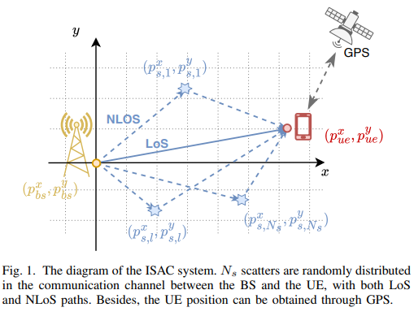
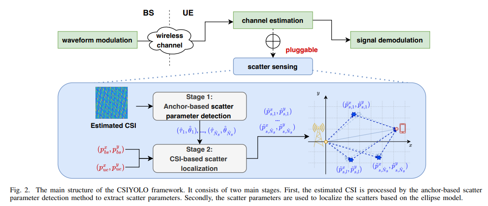
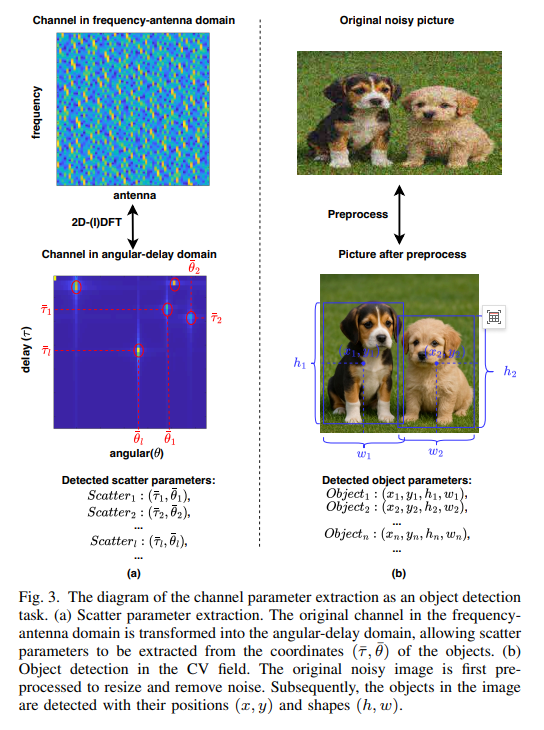
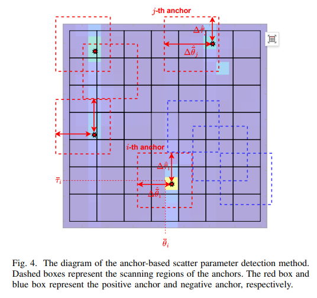
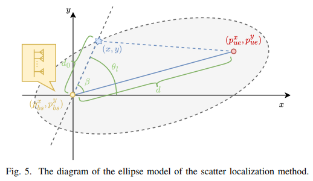
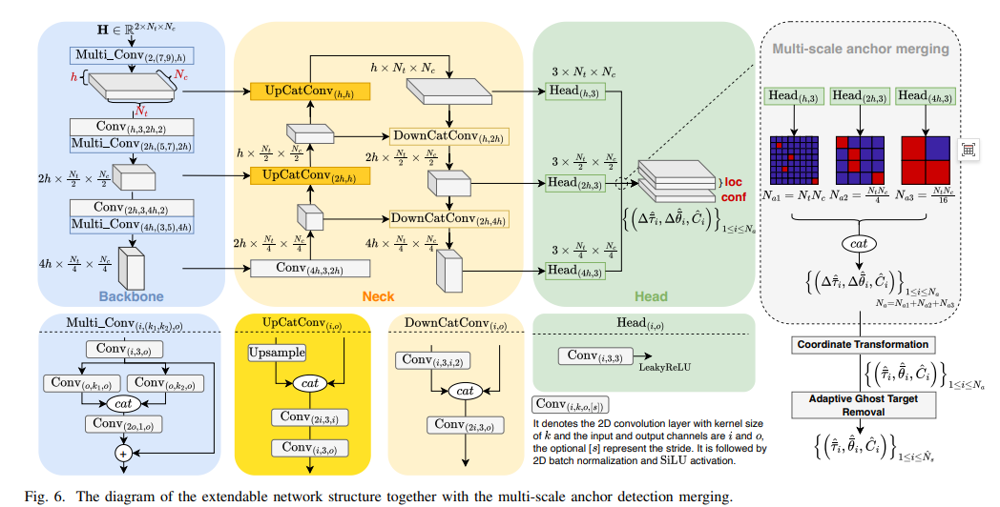
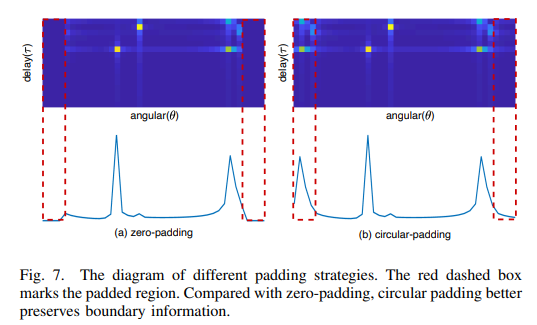
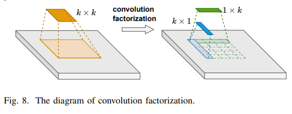
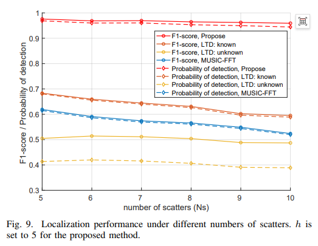
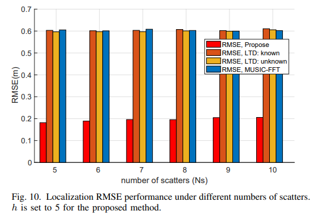
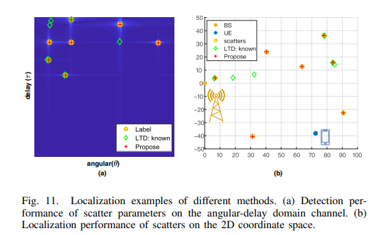
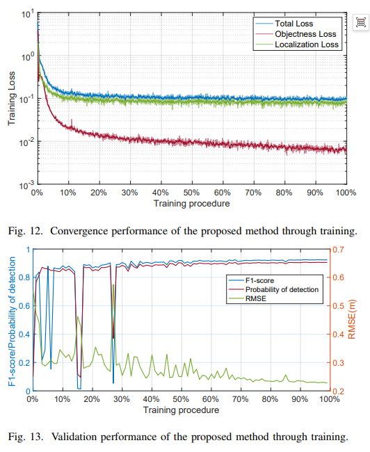
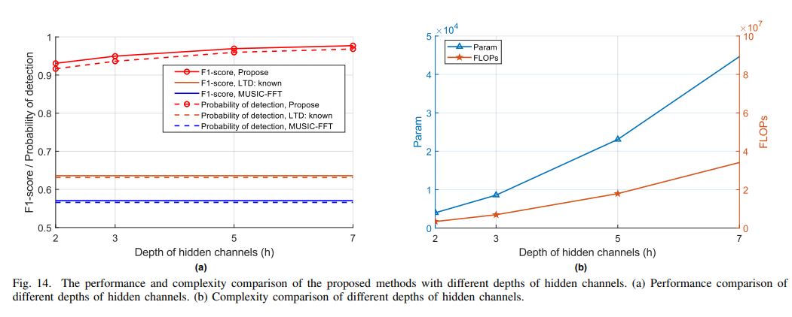
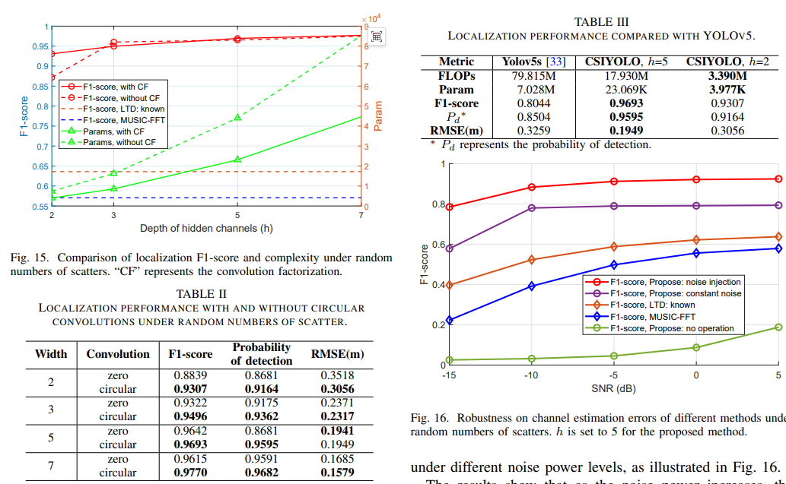

<!-- PAYMENT_BLOCK -->

## Get this dataset

- Payment link (Stripe): [Buy now](https://buy.stripe.com/3cs8yP7sY87d0vu9AB)
- Payment QR code: 

<!-- /PAYMENT_BLOCK -->
